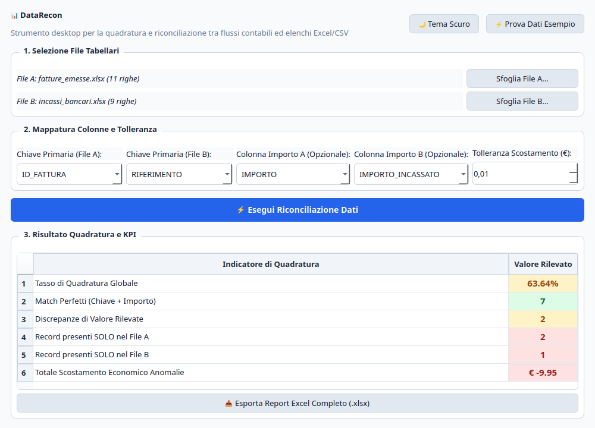
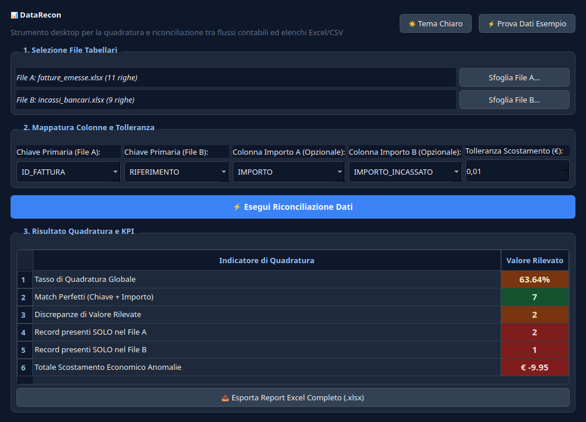

# 📊 DataRecon — Audit & Reconciliation Desktop Tool


-41CD52?logo=qt&logoColor=white)

[](https://github.com/Symon180/DataRecon/actions/workflows/ci.yml)


**DataRecon** è un'applicazione desktop e motore di automazione in **Python** per la quadratura, riconciliazione e audit di grandi volumi di dati tabellari (**Excel `.xlsx` / `.csv`**).

Nata dall'esperienza pratica nella gestione di billing e anomalie contabili, sostituisce i lenti e fragili fogli di calcolo manuali (`CERCA.VERT` / `CERCA.X`) con uno strumento **veloce, deterministico e ripetibile**, dotato di un'interfaccia grafica moderna ad alto contrasto pensata per colleghi d'ufficio e revisori non tecnici.

---

## 📸 Anteprima Interfaccia (Tema Chiaro & Tema Scuro)

| Tema Chiaro | Tema Scuro |
| :---: | :---: |
|  |  |

---

## ✨ Funzionalità Principali

* **⚡ Quadratura Automatica su Chiave Primaria:** Join e confronto deterministico tra File A (es. gestionale interno/fatture) e File B (es. estratti conto bancari, distributori, flussi esterni).
* **🔍 Rilevamento Intelligente delle Anomalie:**
  * **Discrepanze di Valore:** Scostamenti numerici con soglia di tolleranza configurabile (es. per individuare arrotondamenti o commissioni non scorporate).
  * **Record Orfani:** Identificazione immediata di record presenti solo in A o solo in B.
  * **Duplicati:** Tracciamento di chiavi duplicate per prevenire doppie contabilizzazioni.
* **🛡️ Normalizzazione Robusta dell'Input:**
  * Pulizia automatica di spazi bianchi accidentali (`" FAT-001 " -> "FAT-001"`).
  * Gestione di formattazioni sporche, numeri convertiti in testo o formati misti `.xlsx` e `.csv`.
* **📥 Esportazione Report Excel Multi-Foglio Professionale:**
  * Genera un file `.xlsx` formattato con foglio `RIEPILOGO_KPI` per il management, fogli dedicati con evidenziazione cromatica per ogni tipologia di anomalia (`DISCREPANZE`, `SOLO_IN_A`, `SOLO_IN_B`, `DUPLICATI`, `MATCH_PERFETTI`).
* **🎨 Interfaccia Grafica Desktop (PySide6 / Qt6):**
  * Supporto nativo per **Tema Chiaro** e **Tema Scuro** con contrasto cromatico garantito (norme di accessibilità visiva).
  * Pulsante per caricare istantaneamente uno **scenario di dati sintetici** di prova.

---

## 🛠️ Stack Tecnologico e Architettura

* **Linguaggio:** Python 3.12+
* **Interfaccia Grafica:** PySide6 (Qt6 for Python)
* **Elaborazione Dati:** Pandas, OpenPyXL, NumPy
* **Test Automatizzati:** Pytest
* **Packaging Desktop:** PyInstaller (eseguibile stand-alone `.exe`)

### Struttura del Progetto

```text
DataRecon/
├── CODICE/
│   ├── app.py                     # Entry point applicativo desktop
│   ├── maschera.py                # Interfaccia grafica Qt6 (PySide6)
│   ├── motore.py                  # Algoritmo puro di riconciliazione e calcolo KPI
│   ├── lettura.py                 # Ingestion e normalizzazione file Excel/CSV
│   ├── scrittura.py               # Generatore di report Excel multi-foglio
│   └── SVILUPPO/
│       ├── genera_dati_esempio.py # Generatore di scenari realistici di simulazione
│       └── screenshot_maschera.py # Script di cattura screenshot headless
├── TEST/
│   └── test_motore.py             # Suite di unit test (casi limite e quadratura)
├── DATI_ESEMPIO/                  # File Excel di test inclusi nel repository
├── docs/                          # Screenshot per la documentazione
├── pytest.ini                     # Configurazione suite di test
├── requirements.txt               # Dipendenze applicative
├── LICENSE                        # Licenza open-source MIT
└── README.md                      # Questa documentazione
```

---

## 🚀 Guida all'Installazione ed Esecuzione

### 1. Clonare il repository

```bash
git clone https://github.com/Symon180/DataRecon.git
cd DataRecon
```

### 2. Configurare l'ambiente virtuale

Usando il gestore moderno `uv` (consigliato per velocità):
```bash
uv venv
source .venv/bin/activate
uv pip install -r CODICE/requirements.txt
```

Oppure con il classico `venv` e `pip`:
```bash
python3 -m venv .venv
source .venv/bin/activate  # Su Windows: .venv\Scripts\activate
pip install -r CODICE/requirements.txt
```

### 3. Avviare l'applicazione

```bash
python CODICE/app.py   # oppure avvia.sh (Linux) / avvia.bat (Windows)
```

Premi il pulsante **"⚡ Prova Dati Esempio"** in alto a destra per vedere immediatamente il software in azione sui dati di prova inclusi!

---

## 🧪 Esecuzione della Suite di Test

Per eseguire i test unitari automatizzati:

```bash
pytest
```

I test verificano la gestione di chiavi sporche, soglie di tolleranza su centesimi, rilevamento duplicati ed esportazione Excel.

---

## 👤 Autore & Licenza

* **Autore:** [Simone Mariotti](https://github.com/Symon180)
* **Licenza:** Rilasciato sotto licenza [MIT](LICENSE).
